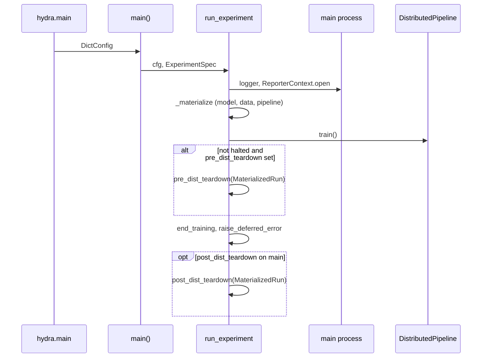

# Running an experiment

Hydra examples enter training through `run_experiment`. You pass a frozen `ExperimentSpec` that wires model, data, and optional hooks; the runner builds an Accelerate `DistributedPipeline`, trains, then tears down the process group. API reference: [experiment](api/experiment.md).

For metrics backends, see [Experiment tracking](reporter.md). For the inner training loop, see [Training loop](training.md).

## Stack overview



`get_train_class()` still returns `MyDistributedPipeline` with `MyTrainingConfig`. Even a single-process run constructs an `Accelerator`.

## Hydra config sections

`run_experiment` expects these top-level keys (see `example/*/config.yaml`):

| Section | Role |
| --- | --- |
| `train` | Steps/epochs, batch size, save/eval/log strategy, `save_dir`, seed, mixed precision |
| `log` | File logger directory and log interval |
| `reporter` | `none`, `mlflow`, or `wandb` — see [Experiment tracking](reporter.md) |
| `mlflow` | Passed when `reporter: mlflow` |
| `wandb` | Passed when `reporter: wandb` |

Task-specific blocks (`gm`, `vae`, `dataset`, …) are read only by your `get_model` / `get_dataset` functions.

## ExperimentSpec

| Field | Required | Purpose |
| --- | --- | --- |
| `get_model` | yes | `(cfg, **kwargs) -> model` or a bundle dict with `"model"` and optional `"train_hook_handlers"` |
| `get_dataset` | yes | `(cfg) -> (train, val, test)` |
| `get_collate` | yes | `(cfg) -> collate_fn` |
| `get_optimizer` | no | Defaults to `get_optimizer` from `utils_for_main` |
| `save_dir_suffix` | no | Appended to `train.save_dir` (e.g. sweep suffix) |
| `disable_train_hooks` | no | Default `True`; disables handlers in `train_hook_handlers` |
| `pre_dist_teardown` | no | See [Pre-distributed teardown](#pre-distributed-teardown) |
| `post_dist_teardown` | no | See [Post-distributed teardown](#post-distributed-teardown) |

Canonical pattern (`example/butterfly_edm/main.py`):

```python
SPEC = ExperimentSpec(
    get_model=get_model,
    get_dataset=get_dataset,
    get_collate=get_collate_fn,
    post_dist_teardown=post_dist_teardown,
)

@hydra.main(config_path=".", config_name="config", version_base=None)
def main(cfg: DictConfig):
    run_experiment(cfg, SPEC)
```

## MaterializedRun

`MaterializedRun` is built in `_materialize` before `pipeline.train()`. Teardown hooks receive the same object after training, with `pipeline` reflecting post-train state (latest checkpoint path, halt flag, etc.).

Fields include `cfg`, `accelerator`, `reporter`, `model_bundle`, datasets, optimizer, scheduler, configs, `collate_fn`, and `pipeline`.

## Pre-distributed teardown

`pre_dist_teardown(run)` runs on **every rank** when:

- `pipeline.train()` has returned,
- the pipeline is **not** halted (`_halt` is false),
- the process group is **still alive** (before the first `accelerator.end_training()` in `_finish`).

Use this for work that must stay distributed (second training phase, collective metrics) while the same reporter remains open.

## Post-distributed teardown

`post_dist_teardown(run)` runs on **`accelerator.is_main_process` only**, after:

1. `accelerator.wait_for_everyone()`
2. `accelerator.end_training()` (process group destroyed)
3. `raise_deferred_error()` (surfaces rank-local failures deferred during training)

Use this for sampling, plotting, and other single-process work that should not hold the distributed group open. The butterfly EDM example loads the latest checkpoint and writes PNGs here.

If training or reporter setup fails, `run_experiment` destroys the group early and **does not** call `post_dist_teardown`.

## Artifacts and working directory

Checkpoints, logs, the MLflow database, and Hydra output use **paths relative to the current working directory**, usually under `artifacts/`.

| Start from | Example artifact root |
| --- | --- |
| `example/butterfly_edm/` | `example/butterfly_edm/artifacts/` |
| Repository root | `<repo>/artifacts/` |

A run started in the example directory does not resume a run started at the repo root. Use the same launch directory when resuming.

From the repo root you can use:

```bash
uv run python example/butterfly_edm/main.py
bash scripts/mc-run-python.sh example/butterfly_edm/main.py
```

See [scripts/README.md](https://github.com/zeroDtree/mlkit/blob/main/scripts/README.md) for GPU launchers and environment variables.

## See also

- [Experiment tracking](reporter.md) — `cfg.reporter`, resume, and callbacks
- [Training loop](training.md) — epochs vs steps, save/eval/halt
- [Learning rate](learning-rate.md) — scheduler length under Accelerate
- [experiment API](api/experiment.md)