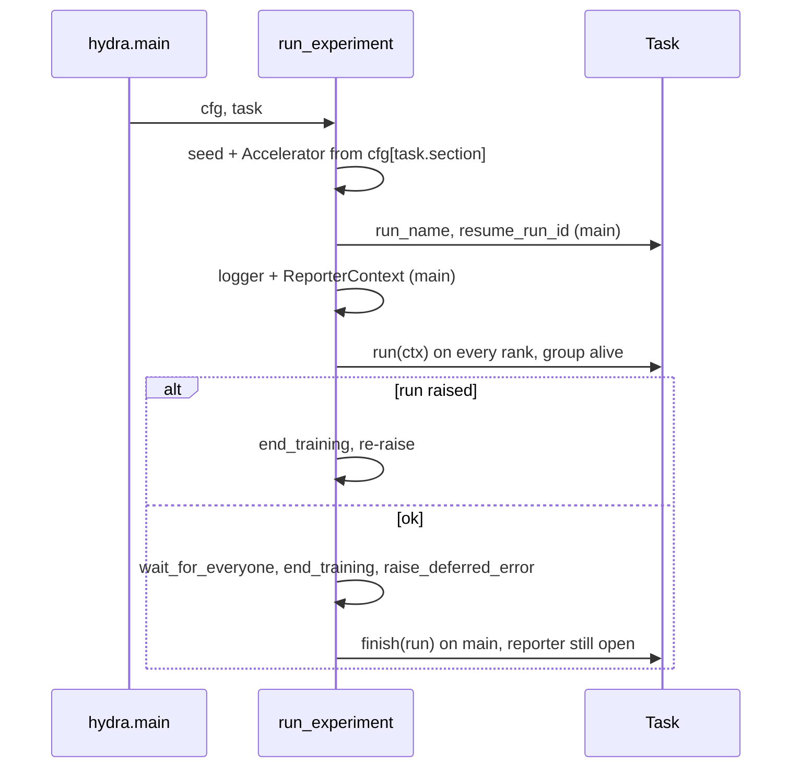

# Running an experiment

Hydra examples enter through `run_experiment(cfg, task)`. The runner owns the distributed lifecycle: seed, `Accelerator`, file logger, reporter, and process-group teardown. The `Task` owns the work. Two tasks ship with mlkit: `TrainSpec` trains a model, and `InferSpec` loads the trained weights and runs inference. API reference: [experiment](api/experiment.md).

For metrics backends, see [Experiment tracking](reporter.md). For the inner training loop, see [Training loop](training.md).

## Lifecycle



`run_experiment` returns the object that `task.run` returned on this rank. If the reporter fails to open on the main process, every rank stops before `task.run`. If `task.run` raises, the group is destroyed without a barrier and `finish` is skipped. A barrier failure still destroys the group, then propagates. A failure to destroy the group is logged on every rank (through the `mlkit.util.experiment.runner` logger where there is no file logger) and does not fail the run. Even a single-process run constructs an `Accelerator`. Each main-process run writes its text log to `log.log_dir/<timestamp>_<pid>/log.txt`.

## Hydra config sections

`run_experiment` expects these top-level keys (see `example/*/config.yaml`):

| Section | Role |
| --- | --- |
| `train` | Steps/epochs, batch size, save/eval/log strategy, `save_dir`, seed, mixed precision |
| `infer` | Seed, mixed precision, and checkpoint for `InferSpec` |
| `log` | File logger directory and log interval |
| `reporter` | `none`, `mlflow`, or `wandb` — see [Experiment tracking](reporter.md) |
| `mlflow` | Passed when `reporter: mlflow` |
| `wandb` | Passed when `reporter: wandb` |

The task's `section` picks which block supplies `seed` and `mixed_precision`: `train` for `TrainSpec`, `infer` for `InferSpec`. Task-specific blocks (`gm`, `vae`, `dataset`, …) are read only by your `get_model` / `get_dataset` functions.

## Training: TrainSpec

| Field | Required | Purpose |
| --- | --- | --- |
| `get_model` | yes | `(cfg) -> model` or a bundle dict with `"model"` and optional `"callbacks"` and `"train_hook_handlers"` |
| `get_dataset` | yes | `(cfg) -> (train, val, test)` |
| `get_collate` | yes | `(cfg) -> collate_fn` |
| `get_optimizer` | no | Defaults to `get_optimizer` from `utils_for_main` |
| `run_suffix` | no | Appended to both the run name and the checkpoint directory (e.g. sweep suffix) |
| `disable_train_hooks` | no | Default `True`; disables handlers in `train_hook_handlers` |
| `after_train` | no | `(TrainRun) -> None`, see [Hooks](#hooks) |
| `on_finish` | no | `(TrainRun) -> None`, see [Hooks](#hooks) |

Canonical pattern (`example/butterfly_edm/main.py`):

```python
SPEC = TrainSpec(
    get_model=get_model,
    get_dataset=get_dataset,
    get_collate=get_collate_fn,
)

@hydra.main(config_path=".", config_name="config", version_base=None)
def main(cfg: DictConfig):
    run_experiment(cfg, SPEC)
```

`TrainSpec.run` builds the model, data, optimizer, scheduler, and a `MyDistributedPipeline` (from `get_train_class()`), then calls `pipeline.train()`. Bundle `"callbacks"` go to the pipeline constructor, ahead of the reporter callback. They are registered before the checkpoint load, so they also see `POST_LOAD` on resume. The pipeline is seeded with `train.seed`. When the latest checkpoint carries a `report_run.json` for the configured backend, the tracked run resumes.

Checkpoints go under `checkpoint_root(cfg, run_suffix)`, which `InferSpec` uses too. When `train.save_dir` is empty or null, `checkpoint_root` returns `""`, the pipeline does not save, and inference must set `infer.checkpoint_dir`. A `ConfigSnapshotCallback` writes the resolved config, including the scheduler rewrite, into every published checkpoint as `config.yaml`. Add one to any extra pipeline you train in a hook (`example/moon_rectified_flow/main.py` does) so its checkpoints are self-describing too.

`TrainRun` holds `cfg`, `accelerator`, `logger`, `reporter`, `model_bundle`, the datasets, optimizer, scheduler, configs, `collate_fn`, and `pipeline`. Hooks receive it after training, with `pipeline` reflecting post-train state (latest checkpoint path, halt flag, etc.).

## Inference: InferSpec

| Field | Required | Purpose |
| --- | --- | --- |
| `get_model` | yes | Same builder as training; the model is constructed, then the checkpoint is loaded into it |
| `get_dataset` | no | `(cfg) -> (train, val, test)` when inference needs data (inpainting, reconstructions) |
| `infer` | no | `(InferRun) -> Any` on every rank; the return value is stored in `run.outputs` |
| `on_finish` | no | `(InferRun) -> None` on the main process, see [Hooks](#hooks) |
| `run_suffix` | no | Must match the training `run_suffix` so the same checkpoint directory is found |

`InferSpec.run` does the following on every rank:

1. Resolve the checkpoint: `infer.checkpoint_dir` when set, otherwise the latest `checkpoint_*` under `checkpoint_root(cfg, run_suffix)`. That directory is derived from `train.save_dir`, `model.name`, `dataset.name`, `optimizer.lr`, `train.batch_size`, and `run_suffix`, so pass the same overrides you trained with. No checkpoint raises `FileNotFoundError`.
2. Load the checkpoint's `config.yaml` into `run.train_cfg`. On the main process, log a warning that lists every value that differs from the current config, ignoring the runtime sections (`train`, `infer`, `optimizer`, `log`, `reporter`, `mlflow`, `wandb`). A sampling value you change on purpose shows up there too; a checkpoint without `config.yaml` logs that the check was skipped.
3. Build the bundle with `get_model` and disable its `train_hook_handlers`.
4. Load `model.safetensors` strictly; a missing or unexpected key raises instead of silently keeping random weights. Strict loading catches shape changes; the config warning catches values that keep the shapes.
5. Move the model to `accelerator.device` in eval mode, load the datasets, and call `infer`.

`infer` and `on_finish` both run under `accelerator.autocast()`, so `infer.mixed_precision` (for example `bf16`) applies to them. The framework does not add `torch.no_grad()`, because classifier guidance and Langevin sampling need gradients; wrap pure forward passes yourself.

`InferRun` holds `cfg`, `accelerator`, `logger`, `reporter`, `model_bundle`, `checkpoint_dir`, `train_cfg`, `train_set`, `val_set`, `test_set` (each `None` without `get_dataset`), and `outputs`. Each inference opens a new tracked run named after the training run with an `-infer` suffix; it never resumes the training run.

Every example config has an `infer` block:

```yaml
infer:
  seed: 0
  mixed_precision: null  # a bare `no` would parse as YAML false
  checkpoint_dir: null   # null = latest checkpoint for this training run
```

Each `main*.py` has a matching `infer*.py` that uses the same config file (`example/butterfly_edm/infer.py`):

```python
SPEC = InferSpec(
    get_model=get_model,
    get_dataset=get_dataset,
    on_finish=on_finish,  # sampling and plots
)
```

```bash
uv run python main.py train.lr=1e-3
uv run python infer.py train.lr=1e-3                       # latest checkpoint of that run
uv run python infer.py infer.checkpoint_dir=/path/to/checkpoint_epoch0_step100_global100
```

## Hooks

`after_train(run)` (`TrainSpec` only) and `infer(run)` (`InferSpec` only) run on **every rank** inside `Task.run`, while the process group is still alive. `after_train` runs after `pipeline.train()` returns and is skipped when `pipeline.halted`. Use these for work that must stay distributed (a second training phase, sharded inference, collective metrics) while the same reporter remains open.

`on_finish(run)` runs on **`accelerator.is_main_process` only**, inside `Task.finish`, after:

1. `accelerator.wait_for_everyone()`
2. `accelerator.end_training()` (process group destroyed)
3. `raise_deferred_error()` (surfaces rank-local failures deferred during the run)

Use it for sampling, plotting, and other single-process work that should not hold the distributed group open. The reporter is still open, so `run.reporter.log(...)` reaches the tracked run (see `example/moon_vae/infer.py`).

If reporter setup or `task.run` fails, `run_experiment` destroys the group early and **does not** call `on_finish`.

## Custom tasks

Subclass `Task`, name the config section that supplies `seed` and `mixed_precision`, and return a `RunContext` subclass from `run`:

```python
@dataclass(kw_only=True)
class EvalRun(RunContext):
    score: float


class Evaluate(Task[EvalRun]):
    section = "eval"

    def run_name(self, cfg: DictConfig) -> str:
        return f"{cfg.model.name}-eval"

    def run(self, ctx: RunContext) -> EvalRun:
        score = ...  # every rank, process group alive
        return EvalRun(cfg=ctx.cfg, accelerator=ctx.accelerator, logger=ctx.logger, reporter=ctx.reporter, score=score)

    def finish(self, run: EvalRun) -> None:
        run.reporter.log({"score": run.score})  # main process only
```

Override `resume_run_id(cfg, backend)` to continue an existing tracked run; the default opens a new one.

## Artifacts and working directory

Checkpoints, logs, the MLflow database, and Hydra output use **paths relative to the current working directory**, usually under `artifacts/`.

| Start from | Example artifact root |
| --- | --- |
| `example/butterfly_edm/` | `example/butterfly_edm/artifacts/` |
| Repository root | `<repo>/artifacts/` |

A run started in the example directory does not resume a run started at the repo root, and inference finds checkpoints only under the directory it starts from. Use the same launch directory for training, resuming, and inference.

From the repo root you can use:

```bash
uv run python example/butterfly_edm/main.py
uv run python example/butterfly_edm/infer.py
bash scripts/mc-run-python.sh example/butterfly_edm/main.py
```

See [scripts/README.md](https://github.com/zeroDtree/mlkit/blob/main/scripts/README.md) for GPU launchers and environment variables.

## See also

- [Experiment tracking](reporter.md) — `cfg.reporter`, resume, and callbacks
- [Training loop](training.md) — epochs vs steps, save/eval/halt
- [Learning rate](learning-rate.md) — scheduler length under Accelerate
- [experiment API](api/experiment.md)
